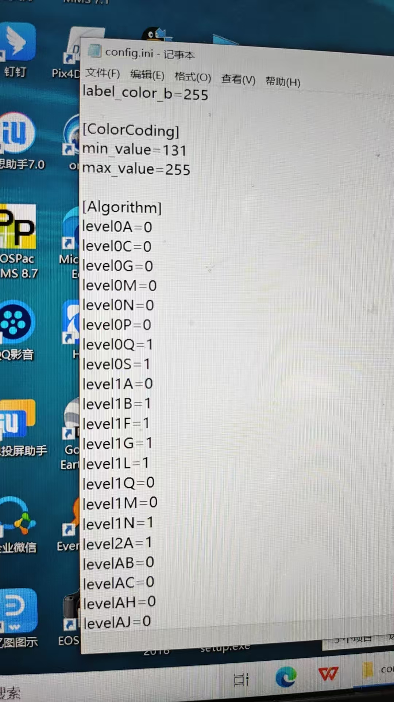

# Beike_dom60_lidar

Companion repository for the SureStar / BeiKe TianHui **DOM60 (Dome)** LiDAR:

- **StarRos v5.6.1**: official ROS driver (ROS1 / ROS2)
- **FAST-LIO V1.2**: LiDAR-inertial odometry adapted for DOM60 point clouds and the built-in IMU
- **StarView 2.1.0**: Windows host software

Repository: [gitee.com/xiaobai0818/Beike_dom60_lidar](https://gitee.com/xiaobai0818/Beike_dom60_lidar)

[中文](README.md)

---

## Layout

```text
Beike_dom60_lidar/
├── StarRos_v5.6.1/              # Official SureStar ROS driver
│   ├── starros_ros1/            # ROS1 (Kinetic / Melodic / Noetic)
│   ├── starros_ros2/            # ROS2 (Foxy / Galactic / Humble)
│   └── so/                      # Prebuilt SDKs (x86 / ARM)
├── FAST-LIO/                    # FAST-LIO workspace
│   └── src/
│       ├── fast_lio_V1.2/       # DOM60 preprocess added (lidar_type=4)
│       ├── livox_ros_driver-2.6.0/   # FAST-LIO build dependency
│       └── Livox-SDK-2.3.0/     # Required by livox_ros_driver
├── StarView-2.1.0.exe           # Windows host software
├── README.md
└── README.en.md
```

---

## Hardware and network

Factory defaults — the host NIC must be on the same subnet:

| Item | Default |
| --- | --- |
| LiDAR IP | `192.168.0.10` |
| Point-cloud port | `2014` |
| IMU port | `2025` |
| Heartbeat port | `2030` |
| ISF header port | `11000` |
| Data protocol | `0x071e` |
| Scan lines | 8 |
| FOV | 360° |

Example host address:

```bash
sudo ip addr add 192.168.0.2/24 dev eth0
# or
sudo ifconfig eth0 192.168.0.2 netmask 255.255.255.0
```

Check connectivity:

```bash
ping 192.168.0.10
```

If the device uses a different IP or ports, edit `device_ip` and the port fields in `StarRos_v5.6.1/starros_ros1/launch/config/Dome.yaml` (ROS2: `starros_ros2/launch/config/Dome.yaml`).

---

## Requirements

### Driver (StarRos)

| OS | ROS |
| --- | --- |
| Ubuntu 16.04 | ROS Kinetic |
| Ubuntu 18.04 | ROS Melodic |
| Ubuntu 20.04 | ROS Noetic or ROS2 Foxy / Galactic |
| Ubuntu 22.04 | ROS2 Humble |

```bash
sudo apt install libyaml-cpp-dev
# PCAP replay only
sudo apt install libpcap-dev
```

The default linked SDK is **x86**. On ARM, copy the matching `.so` files:

```text
StarRos_v5.6.1/so/<arch>/lib/*.so
        ↓
starros_ros1/3rdparty/sdk/lib/   # or starros_ros2/3rdparty/sdk/lib/
```

Available trees: `linux x86`, `gcc-linaro-4.9.4`, `gcc-linaro-7.5.0`, `gcc-arm-9.2-2019.12-x86`, `arm-gnu-toolchain-11.3.rel1`.

### FAST-LIO

- Ubuntu 18.04 / 20.04 + ROS Melodic / Noetic (this adaptation is ROS1)
- Eigen3, PCL ≥ 1.8, `livox_ros_driver` (already in the repo; compile-time only)

```bash
sudo apt install libeigen3-dev libpcl-dev
```

---

## 1. Start the driver

### ROS1

Place `starros_ros1` in its own workspace (keep it separate from the FAST-LIO workspace):

```bash
mkdir -p ~/starros_ws/src
ln -s /path/to/Beike_dom60_lidar/StarRos_v5.6.1/starros_ros1 ~/starros_ws/src/starros
cd ~/starros_ws
catkin_make
source devel/setup.bash
roslaunch starros Dome.launch
```

RViz opens automatically. Published topics:

| Topic | Type | Notes |
| --- | --- | --- |
| `/points_raw` | `sensor_msgs/PointCloud2` | Point cloud, `frame_id=world` |
| `/imu_raw` | `sensor_msgs/Imu` | Built-in IMU |

### ROS2

```bash
mkdir -p ~/starros_ws/src
ln -s /path/to/Beike_dom60_lidar/StarRos_v5.6.1/starros_ros2 ~/starros_ws/src/starros
cd ~/starros_ws
colcon build
source install/setup.bash
ros2 launch starros Dome.launch.py
```

Other models: `RFans.launch`, `CFans.launch`, `CK128.launch` (ROS2 uses the matching `.launch.py`).

---

## 2. Driver configuration (`Dome.yaml`)

```yaml
model: "Dome"
frame_id: "world"
pointcloud_topic: "points_raw"
imu_topic: "imu_raw"

device_ip: "192.168.0.10"
data_port: 2014
imu_port: 2025
heart_port: 2030
isf_header_port: 11000

time_sync: true          # Enable only after the device itself is time-synced
data_proto: 0x071e       # Must match the device protocol
mode_type: 2             # 1 = no protective window, 2 = with window
use_algorithm: true      # SDK range / intensity algorithms
```

### Extrinsics (optional)

ZYX Euler rotation plus translation applied to the cloud:

```yaml
extrinsin_enable: true
extrinsic_yaw: 0      # deg
extrinsic_pitch: 0
extrinsic_roll: 0
extrinsic_tx: 0       # m
extrinsic_ty: 0
extrinsic_tz: 0
```

### Record raw ISF

```yaml
save_isf: true
save_isf_path: "/home/xxx/data"
```

### Offline replay

- **ISF**: set `isf_path` to the `.isf` file.
- **PCAP**: install `libpcap-dev` and uncomment in `CMakeLists.txt`:

```cmake
add_definitions(-DPCAP)
target_link_libraries(driver_node pcap)
```

Then set `pcap_path` and rebuild.

### Point fields

| Field | Type | Unit |
| --- | --- | --- |
| `x` / `y` / `z` | FLOAT32 | m |
| `intensity` | FLOAT32 | — |
| `ring` | UINT16 | scan line |
| `flag` | UINT16 | echo flag |
| `timestamp` | FLOAT64 | ns |

---

## 3. Multiple LiDARs

Copy the templates under `launch/config/`, then change IPs and topics.

- Independent nodes: `roslaunch starros MultiLidar.launch`
- Soft-sync fusion: `roslaunch starros MultiLidarSync.launch` (fused topic `/fusion_point`)

ROS2 equivalents: `MultiLidar.launch.py` / `MultiLidarSync.launch.py`. Add more units by cloning the existing `ns1` / `ns2` blocks.

---

## 4. FAST-LIO mapping

This tree adds a **DOM60 preprocessor** (`lidar_type: 4` / `DOME8`) that subscribes to `/points_raw` and `/imu_raw`.

### Build

`livox_ros_driver` needs Livox SDK. Install the SDK first, then build the workspace:

```bash
# 1) Livox-SDK (compile-time only; no Livox hardware is required at runtime)
cd /path/to/Beike_dom60_lidar/FAST-LIO/src/Livox-SDK-2.3.0
mkdir -p build && cd build
cmake .. && make
sudo make install

# 2) FAST-LIO workspace
cd /path/to/Beike_dom60_lidar/FAST-LIO
catkin_make
source devel/setup.bash
```

### Run

Start the driver, then mapping:

```bash
# Terminal 1
source ~/starros_ws/devel/setup.bash
roslaunch starros Dome.launch

# Terminal 2
source /path/to/Beike_dom60_lidar/FAST-LIO/devel/setup.bash
roslaunch fast_lio mapping_dome.launch
```

Use `FAST-LIO/src/fast_lio_V1.2/rviz_cfg/loam_livox.rviz` if needed. `mapping_dome.launch` does not start RViz by default; uncomment the RViz node or launch it yourself.

### Key parameters (`fast_lio_V1.2/config/dome.yaml`)

```yaml
common:
    lid_topic:  "/points_raw"
    imu_topic:  "/imu_raw"
    time_sync_en: false     # Keep false when the driver already stamps device time

preprocess:
    lidar_type: 4           # 4 = BeiKe DOM60
    scan_line: 8
    blind: 0.5              # near-range blind zone (m)
    timestamp_unit: 3       # 3 = ns, matches the driver timestamp field

mapping:
    fov_degree: 360
    det_range: 200
    extrinsic_est_en: false
    # Built-in IMU /imu_raw
    extrinsic_T: [ -0.011, -0.028, 0.028 ]
    extrinsic_R: [  1, 0, 0,
                    0, -1, 0,
                    0, 0, -1]
```

Commented blocks in the same file cover other IMU mounts (`kws_imu`, external IMU). Change `imu_topic` and the extrinsics together.

### Output topics

| Topic | Meaning |
| --- | --- |
| `/Odometry` | Odometry |
| `/path` | Trajectory |
| `/cloud_registered` | Cloud in world frame |
| `/cloud_registered_body` | Cloud in IMU body frame |
| `/Laser_map` | Local map |

PCD dump is controlled by `pcd_save.pcd_save_en`. On shutdown:

- Full map: `FAST-LIO/src/fast_lio_V1.2/Log/map.pcd`
- Per-scan (`interval > 0`): `Log/scans/scans_*.pcd`

`interval: -1` writes every frame into one file and can exhaust memory on long runs.

---

## 5. Windows host software

`StarView-2.1.0.exe` is the official Windows viewer / configuration tool.

1. Set the Windows NIC to `192.168.0.x` (do not collide with the LiDAR IP)
2. Run `StarView-2.1.0.exe`
3. Connect to `192.168.0.10` to view the cloud, change device settings, or record data

Do not run the Linux driver and StarView against the same UDP ports at the same time.

### Required `config.ini` changes

Stock StarView color / algorithm flags are not suitable for DOM60. **Before first use**, open `config.ini` next to the executable and set the following (restart StarView afterwards):



```ini
labelcolor_b=255

[ColorCoding]
minvalue=131301
maxvalue=255

[Algorithm]
level0A=0
level0C=0
level0G=0
level0M=0
level0N=0
level0P=0
level0Q=1
level0S=1
level1A=0
level1B=1
level1F=1
level1G=1
level1L=1
level1Q=0
level1M=0
level1N=1
level2A=1
levelAB=0
levelAC=0
levelAH=0
levelAJ=0
```

The flags that must be `1` match the ROS driver `Dome.yaml`:

| `config.ini` | `Dome.yaml` | Meaning |
| --- | --- | --- |
| `level0Q=1` | `Level0Q: true` | Window-based echo filter |
| `level0S=1` | `Level0S: true` | Time-window filter |
| `level1B=1` | `Level1B: true` | Range correction (pulse width) |
| `level1F=1` | `Level1F: true` | Range correction (temperature) |
| `level1G=1` | `Level1G: true` | Mid/far range correction |
| `level1L=1` | `Level1L: true` | 12-bit intensity stretch |
| `level1N=1` | `Level1N: true` | Pulse-width range correction |
| `level2A=1` | `Level2A: true` | 12-bit to 8-bit linear stretch |

Leave the other `level*` keys at `0`. `[ColorCoding]` `minvalue` / `maxvalue` set the intensity color range; without them the cloud contrast looks wrong.

---

## Troubleshooting

**1. `starros` cannot find `StarSDK_4` / `DevCtrl`**

Make sure the `.so` files exist under `3rdparty/sdk/lib/`. On ARM, replace them as described above. If the runtime linker fails:

```bash
export LD_LIBRARY_PATH=$LD_LIBRARY_PATH:$(rospack find starros)/3rdparty/sdk/lib
```

**2. Ping works but no points**

- Host IP must be in `192.168.0.0/24`
- `data_proto` must match the device (DOM60 default `0x071e`)
- Firewall must allow UDP `2014` / `2025` / `2030`
- `mode_type` must match whether a protective window is installed

**3. FAST-LIO cannot find `livox_ros_driver`**

Install Livox-SDK first, then `catkin_make` inside `FAST-LIO`. No Livox sensor is needed at runtime; the package only provides message types.

**4. Drift or misalignment**

- Subscribe to `/imu_raw` and keep the built-in IMU extrinsics in `dome.yaml`
- Keep device `time_sync` consistent; leave FAST-LIO `time_sync_en` off
- For small indoor scenes, reduce `filter_size_surf` / `filter_size_map`

**5. Wrong point timestamps**

The driver `timestamp` field is nanoseconds. FAST-LIO must use `timestamp_unit: 3` (NS).

---

## Suggested workflow

```text
Wire the network ─► StarRos Dome.launch publishes /points_raw /imu_raw
                       │
                       ├─► RViz for the raw cloud
                       └─► FAST-LIO mapping_dome.launch
                                 └─► Log/map.pcd after shutdown
```

Use StarView on Windows for device setup and inspection. Use the Linux driver + FAST-LIO for ROS mapping.

---

## Acknowledgements

- SureStar / BeiKe TianHui [StarRos](https://www.isurestar.com/) driver and StarView
- [FAST-LIO](https://github.com/hku-mars/FAST_LIO) (HKU MARS Lab)
- Livox SDK / livox_ros_driver (FAST-LIO compile dependency only)
