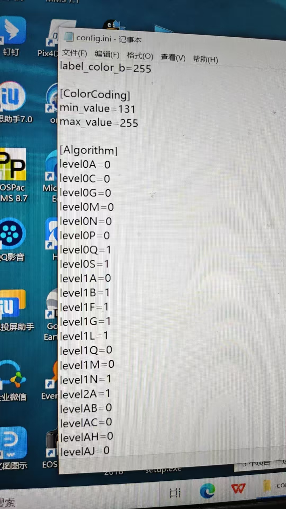

# Beike_dom60_lidar

北科天绘 **DOM60（Dome）** 激光雷达配套仓库，包含：

- **StarRos v5.6.1**：官方 ROS 驱动（ROS1 / ROS2）
- **FAST-LIO V1.2**：已适配 DOM60 点云与内置 IMU 的激光惯性里程计
- **StarView 2.1.0**：Windows 上位机

仓库地址：[gitee.com/xiaobai0818/Beike_dom60_lidar](https://gitee.com/xiaobai0818/Beike_dom60_lidar)

[English](README.en.md)

---

## 目录结构

```text
Beike_dom60_lidar/
├── StarRos_v5.6.1/              # 北科天绘官方 ROS 驱动
│   ├── starros_ros1/            # ROS1（Kinetic / Melodic / Noetic）
│   ├── starros_ros2/            # ROS2（Foxy / Galactic / Humble）
│   └── so/                      # 各架构预编译 SDK（x86 / ARM）
├── FAST-LIO/                    # FAST-LIO 工作空间
│   └── src/
│       ├── fast_lio_V1.2/       # 已增加 DOM60（lidar_type=4）预处理
│       ├── livox_ros_driver-2.6.0/   # FAST-LIO 编译依赖
│       └── Livox-SDK-2.3.0/     # livox_ros_driver 依赖的 SDK
├── StarView-2.1.0.exe           # Windows 上位机
├── README.md
└── README.en.md
```

---

## 硬件与网络

默认出厂网络如下，电脑网口需与雷达同一网段：

| 项目 | 默认值 |
| --- | --- |
| 雷达 IP | `192.168.0.10` |
| 点云端口 | `2014` |
| IMU 端口 | `2025` |
| 心跳端口 | `2030` |
| ISF Header 端口 | `11000` |
| 数据协议 | `0x071e` |
| 线数 | 8 |
| 视场 | 360° |

电脑网口示例：

```bash
sudo ip addr add 192.168.0.2/24 dev eth0
# 或
sudo ifconfig eth0 192.168.0.2 netmask 255.255.255.0
```

确认连通：

```bash
ping 192.168.0.10
```

若实际 IP / 端口与出厂不同，改 `StarRos_v5.6.1/starros_ros1/launch/config/Dome.yaml`（ROS2 对应 `starros_ros2/launch/config/Dome.yaml`）中的 `device_ip`、端口字段。

---

## 环境要求

### 驱动（StarRos）

| 系统 | ROS |
| --- | --- |
| Ubuntu 16.04 | ROS Kinetic |
| Ubuntu 18.04 | ROS Melodic |
| Ubuntu 20.04 | ROS Noetic 或 ROS2 Foxy / Galactic |
| Ubuntu 22.04 | ROS2 Humble |

依赖：

```bash
sudo apt install libyaml-cpp-dev
# 仅 PCAP 回放需要
sudo apt install libpcap-dev
```

默认链接的是 **x86** SDK。交叉编译或在 ARM 板上运行时，把对应架构的 `.so` 拷到驱动目录：

```text
StarRos_v5.6.1/so/<架构>/lib/*.so
        ↓
starros_ros1/3rdparty/sdk/lib/   # 或 starros_ros2/3rdparty/sdk/lib/
```

提供的架构包括 `linux x86`、`gcc-linaro-4.9.4`、`gcc-linaro-7.5.0`、`gcc-arm-9.2-2019.12-x86`、`arm-gnu-toolchain-11.3.rel1`。

### FAST-LIO

- Ubuntu 18.04 / 20.04 + ROS Melodic / Noetic（本仓库适配基于 ROS1）
- Eigen3、PCL ≥ 1.8、`livox_ros_driver`（仓库已带，仅作编译依赖）

```bash
sudo apt install libeigen3-dev libpcl-dev
```

---

## 1. 启动雷达驱动

### ROS1

把 `starros_ros1` 放到独立工作空间（不要和 FAST-LIO 混在同一个 `src` 下编译，两边都叫独立 catkin 包即可）：

```bash
mkdir -p ~/starros_ws/src
ln -s /path/to/Beike_dom60_lidar/StarRos_v5.6.1/starros_ros1 ~/starros_ws/src/starros
cd ~/starros_ws
catkin_make
source devel/setup.bash
roslaunch starros Dome.launch
```

启动后会打开 RViz，并发布：

| 话题 | 类型 | 说明 |
| --- | --- | --- |
| `/points_raw` | `sensor_msgs/PointCloud2` | 点云，`frame_id=world` |
| `/imu_raw` | `sensor_msgs/Imu` | 内置 IMU |

### ROS2

```bash
mkdir -p ~/starros_ws/src
ln -s /path/to/Beike_dom60_lidar/StarRos_v5.6.1/starros_ros2 ~/starros_ws/src/starros
cd ~/starros_ws
colcon build
source install/setup.bash
ros2 launch starros Dome.launch.py
```

同系列其它型号也可直接启动：`RFans.launch`、`CFans.launch`、`CK128.launch`（ROS2 为对应 `.launch.py`）。

---

## 2. 驱动配置（Dome.yaml）

核心字段：

```yaml
model: "Dome"
frame_id: "world"
pointcloud_topic: "points_raw"
imu_topic: "imu_raw"

device_ip: "192.168.0.10"
data_port: 2014
imu_port: 2025
heart_port: 2030
isf_header_port: 11000

time_sync: true          # 设备端已开时间同步时再开
data_proto: 0x071e       # 必须与设备协议一致
mode_type: 2             # 1=无防护窗  2=有防护窗
use_algorithm: true      # 距离/灰度等 SDK 算法
```

### 外参（可选）

开启后按 ZYX 欧拉角旋转 + 平移点云：

```yaml
extrinsin_enable: true
extrinsic_yaw: 0      # °
extrinsic_pitch: 0
extrinsic_roll: 0
extrinsic_tx: 0       # m
extrinsic_ty: 0
extrinsic_tz: 0
```

### 录制 ISF 原始数据

```yaml
save_isf: true
save_isf_path: "/home/xxx/data"
```

### 离线回放

- **ISF**：把 `isf_path` 填成 `.isf` 文件路径即可。
- **PCAP**：先安装 `libpcap-dev`，在 `CMakeLists.txt` 中取消注释：

```cmake
add_definitions(-DPCAP)
target_link_libraries(driver_node pcap)
```

再把 `pcap_path` 填成 `.pcap` 路径后重新编译启动。

### 点云字段

| 字段 | 类型 | 单位 |
| --- | --- | --- |
| `x` / `y` / `z` | FLOAT32 | m |
| `intensity` | FLOAT32 | — |
| `ring` | UINT16 | 线号 |
| `flag` | UINT16 | 回波标志 |
| `timestamp` | FLOAT64 | ns |

---

## 3. 多雷达

配置文件模板在 `launch/config/`。复制多份并改 IP / 话题后：

- **独立发布**：`roslaunch starros MultiLidar.launch`
- **软同步融合**：`roslaunch starros MultiLidar.launch` 对应的是直接多节点；融合版用 `MultiLidarSync.launch`，融合话题为 `/fusion_point`

ROS2 对应 `MultiLidar.launch.py` / `MultiLidarSync.launch.py`。需要更多雷达时，按现有 `ns1`/`ns2` 节点样式追加即可。

---

## 4. FAST-LIO 建图

本仓库已在 FAST-LIO 中增加 **DOM60 预处理**（`lidar_type: 4` / `DOME8`），订阅驱动发布的 `/points_raw` 与 `/imu_raw`。

### 编译

`livox_ros_driver` 依赖 Livox SDK，需先安装 SDK，再编译整个工作空间：

```bash
# 1) 安装 Livox-SDK（仅编译依赖，运行 DOM60 不需要连大疆雷达）
cd /path/to/Beike_dom60_lidar/FAST-LIO/src/Livox-SDK-2.3.0
mkdir -p build && cd build
cmake .. && make
sudo make install

# 2) 编译 FAST-LIO 工作空间
cd /path/to/Beike_dom60_lidar/FAST-LIO
catkin_make
source devel/setup.bash
```

### 运行

先开驱动，再开建图：

```bash
# 终端 1
source ~/starros_ws/devel/setup.bash
roslaunch starros Dome.launch

# 终端 2
source /path/to/Beike_dom60_lidar/FAST-LIO/devel/setup.bash
roslaunch fast_lio mapping_dome.launch
```

RViz 可用 `FAST-LIO/src/fast_lio_V1.2/rviz_cfg/loam_livox.rviz`。`mapping_dome.launch` 默认未自动开 RViz，需要时手动启动或取消 launch 里 RViz 节点的注释。

### 关键参数（`fast_lio_V1.2/config/dome.yaml`）

```yaml
common:
    lid_topic:  "/points_raw"
    imu_topic:  "/imu_raw"
    time_sync_en: false     # 驱动已做设备时间同步时保持 false

preprocess:
    lidar_type: 4           # 4 = 北科 DOM60
    scan_line: 8
    blind: 0.5              # 近距盲区，单位 m
    timestamp_unit: 3       # 3 = ns，与驱动 timestamp 字段一致

mapping:
    fov_degree: 360
    det_range: 200
    extrinsic_est_en: false
    # 内置 IMU /imu_raw
    extrinsic_T: [ -0.011, -0.028, 0.028 ]
    extrinsic_R: [  1, 0, 0,
                    0, -1, 0,
                    0, 0, -1]
```

配置文件里还预留了其它 IMU 安装方案（注释掉的 `kws_imu`、外部 IMU），换 IMU 时改 `imu_topic` 和外参即可。

### 输出话题

| 话题 | 说明 |
| --- | --- |
| `/Odometry` | 里程计 |
| `/path` | 轨迹 |
| `/cloud_registered` | 世界系点云 |
| `/cloud_registered_body` | IMU 体系点云 |
| `/Laser_map` | 局部地图 |

PCD 保存由 `pcd_save.pcd_save_en` 控制，退出节点后写入：

- 整图：`FAST-LIO/src/fast_lio_V1.2/Log/map.pcd`
- 分帧（`interval > 0`）：`Log/scans/scans_*.pcd`

`interval: -1` 表示全部帧写入同一个 PCD，帧数过多可能撑爆内存。

---

## 5. Windows 上位机

根目录 `StarView-2.1.0.exe` 为官方 Windows 可视化 / 配置软件。

1. Windows 电脑网口设为 `192.168.0.x`（不要与雷达 IP 冲突）
2. 双击运行 `StarView-2.1.0.exe`
3. 按软件提示连接 `192.168.0.10`，可查看点云、改设备参数、录制数据

Linux 侧驱动与 Windows 上位机不要同时抢同一端口收包。

### 必须修改 `config.ini`

StarView 默认算法/着色参数不适合 DOM60，**首次使用前**用记事本打开可执行文件同目录下的 `config.ini`，改成下面这组值（改完后重启 StarView）：



```ini
labelcolor_b=255

[ColorCoding]
minvalue=131301
maxvalue=255

[Algorithm]
level0A=0
level0C=0
level0G=0
level0M=0
level0N=0
level0P=0
level0Q=1
level0S=1
level1A=0
level1B=1
level1F=1
level1G=1
level1L=1
level1Q=0
level1M=0
level1N=1
level2A=1
levelAB=0
levelAC=0
levelAH=0
levelAJ=0
```

需要打开的算法（值为 `1`）与 ROS 驱动 `Dome.yaml` 一致：

| `config.ini` | `Dome.yaml` | 含义 |
| --- | --- | --- |
| `level0Q=1` | `Level0Q: true` | 基于窗口回波过滤 |
| `level0S=1` | `Level0S: true` | 时间窗口过滤 |
| `level1B=1` | `Level1B: true` | 距离修正（脉宽） |
| `level1F=1` | `Level1F: true` | 距离修正（温度） |
| `level1G=1` | `Level1G: true` | 距离修正（中远距离） |
| `level1L=1` | `Level1L: true` | 灰度拉伸（12bit） |
| `level1N=1` | `Level1N: true` | 脉宽修正距离 |
| `level2A=1` | `Level2A: true` | 12bit 转 8bit 线性拉伸 |

其余 `level*` 保持 `0`。`[ColorCoding]` 的 `minvalue` / `maxvalue` 控制点云着色灰度范围，按上表设置后点云对比度才正常。

---

## 常见问题

**1. 编译 starros 报找不到 `StarSDK_4` / `DevCtrl`**

确认 `3rdparty/sdk/lib/` 下有对应 `.so`。ARM 平台需按上文替换 so。运行时若提示找不到动态库：

```bash
export LD_LIBRARY_PATH=$LD_LIBRARY_PATH:$(rospack find starros)/3rdparty/sdk/lib
```

**2. 能 ping 通但没有点云**

- 检查电脑 IP 是否在 `192.168.0.0/24`
- 核对 `data_proto` 是否与设备一致（DOM60 默认 `0x071e`）
- 确认防火墙未拦截 UDP `2014` / `2025` / `2030`
- `mode_type` 与是否安装防护窗一致

**3. FAST-LIO 编译找不到 `livox_ros_driver`**

先按上文安装 Livox-SDK，再在 `FAST-LIO` 工作空间里 `catkin_make`。DOM60 运行时不需要大疆雷达，该包只提供消息类型。

**4. 里程计飘或对不齐**

- 确认订阅的是 `/imu_raw`，并使用 `dome.yaml` 里内置 IMU 外参
- 设备端与 `time_sync` 保持一致；FAST-LIO 的 `time_sync_en` 建议关闭
- 室内小场景可适当减小 `filter_size_surf` / `filter_size_map`

**5. 点云时间戳单位不对**

驱动 `timestamp` 为纳秒。FAST-LIO 必须设 `timestamp_unit: 3`（NS）。

---

## 推荐工作流

```text
硬件连网 ─► StarRos Dome.launch 发布 /points_raw /imu_raw
                │
                ├─► RViz 看原始点云
                └─► FAST-LIO mapping_dome.launch 做 LIO 建图
                          └─► 退出后取 Log/map.pcd
```

Windows 仅做设备调试、改参、看点云时用 StarView；ROS 建图走 Linux 驱动 + FAST-LIO。

---

## 致谢

- 北科天绘 [StarRos](https://www.isurestar.com/) 驱动与 StarView
- [FAST-LIO](https://github.com/hku-mars/FAST_LIO)（HKU MARS Lab）
- Livox SDK / livox_ros_driver（仅作为 FAST-LIO 编译依赖）
